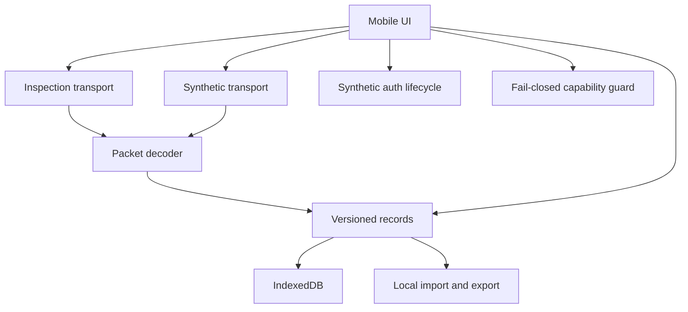
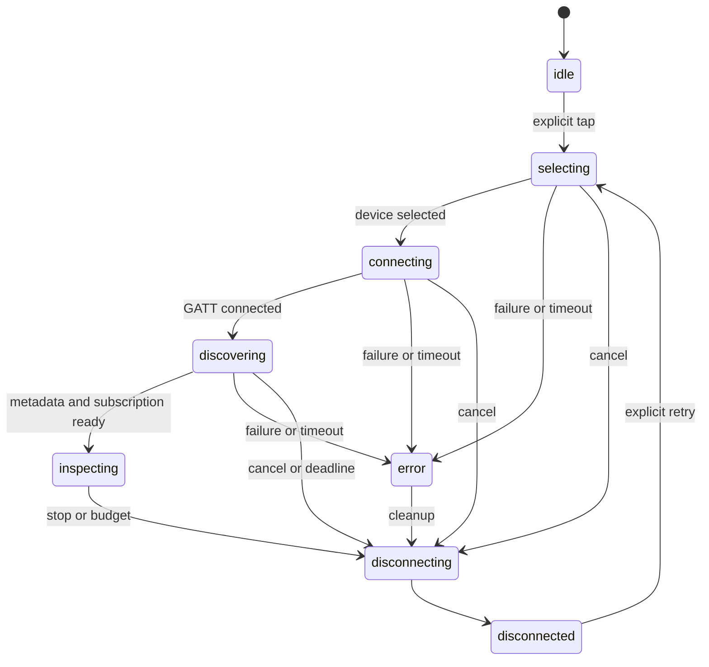

# Architecture and module APIs

The application is buildless HTML/CSS and native JavaScript modules. Runtime dependencies: none. Development tools are pinned in package-lock.json. UI, storage, transport, decoding, and future physical capabilities have separate boundaries.

| Module                  | Contract                                                                                                                                        |
| ----------------------- | ----------------------------------------------------------------------------------------------------------------------------------------------- |
| site/app.js             | DOM controller and routing; handles explicit actions, mode labels, local notes, and reports. Untrusted text uses textContent.                   |
| site/lib/bluetooth.js   | BluetoothTransport.connect(config), disconnect(reason), and event callback. No application write API.                                           |
| site/lib/profiles.js    | Experiment profiles, candidate Elmo GATT registry, UUID validation, and excluded DFU identifiers.                                               |
| site/lib/protocol.js    | decodePacket accepts ArrayBuffer or views, preserves offsets, retains at most 1,024 bytes, and flags malformed input.                           |
| site/elmo-packets.mjs   | Preserved offline parseHex / hexOf / analyzeElmoNotification API. Candidate offset is explicit; no command verification.                        |
| site/lib/auth.js        | Synthetic outcome state machine. No live adapter or credential collection.                                                                      |
| site/lib/safety.js      | All physical capabilities are unverified and blocked. Simulated actions require explicit consent.                                               |
| site/lib/diagnostics.js | Ring-buffer logs, recognized secret-pattern redaction, and actionable error interpretation.                                                     |
| site/lib/records.js     | Versioned envelope, migrations, validation, limits, metadata-only portable records, imports, comparisons.                                       |
| site/lib/storage.js     | IndexedDB v4, atomic capacity checks and writes, corruption detection, temporary memory fallback.                                               |
| site/lib/discovery.js   | Versioned discovery captures, bounded parsers, model/method-separated comparisons, metadata backups, and offline PCM16 WAV/FFT analysis.        |
| site/discovery-ui.js    | Discovery form, saved captures, same-index diff table, and accessible audio plots. No transport or hardware API.                                |
| site/lib/simulation.js  | Finite synthetic fixture playback with synthetic service UUIDs. Never references navigator.bluetooth.                                           |
| site/lib/types.d.ts     | Public packet, evidence, profile, capability, and transport type declarations. Core protocol/profile/guard modules are checked with TypeScript. |

## Device workspace and native hosts

The device hub presents actual connection state separately from saved configuration. Device identities and inspection measurements are snapshotted into session v2's optional inspection field; five prior title/note versions are retained in optional noteHistory. The schema remains compatible with older records without these fields. Imported contexts never complete the physical-evidence checklist.

| Module                         | Contract                                                                                                                                    |
| ------------------------------ | ------------------------------------------------------------------------------------------------------------------------------------------- |
| site/device-hub.js             | Active-device status, per-profile evidence collection, recent sessions, timing table, and offline analysis handoff.                         |
| site/lib/devices.js            | Identity snapshots, shared inspection contract, browser support detection, and evidence candidate assessment.                               |
| site/lib/device-information.js | Standard Device Information UUID/field allowlist, bounded UTF-8 decoding, and imported-field validation.                                    |
| site/lib/connection-result.js  | Connection outcomes and useful next steps; imported/simulated records never supply live channel shortcuts.                                  |
| site/lib/native-bluetooth.js   | Inspection-only facade over the native Capacitor plugin; reuses BluetoothTransport lifecycle and decoding.                                  |
| native/ios                     | Reproducible Capacitor build/generator and Swift Core Bluetooth chooser, scoped discovery, notifications, cancellation, and export sharing. |
| desktop/sasori_ble.py          | Owner-run Bleak inspection and private portable session handoff. No local server or application writes.                                     |

Native assets are bundled locally; no remote web application or browser token is introduced. The iOS native plugin has its own bounded watchdog and background cancellation. The desktop helper uses a local command-line/file handoff instead of opening a web-accessible daemon.

## Live transport state machine

Each run has a generation counter. A cancelled chooser cannot initiate GATT later; a GATT connection that resolves after cancellation is disconnected. Notification listeners and the current disconnect handler are removed on teardown. No reconnect loop exists.

The inspection deadline begins at GATT connection and is armed before discovery. Closing/backgrounding the page stops the inspection. Browser/OS scheduling and power loss still require real-device validation; browser timers are not physical emergency stops.

Events: state, services, device-information, packet, info, warning, error. State events include a disconnect reason. Observed metadata is labeled observed-this-session; synthetic metadata is labeled synthetic. Standard identification requests use only the Device Information service, read five non-unique fields sequentially, emit partial results, then disconnect with identification-complete. The native read API independently restricts access to the same service and field allowlist; it is not a generic characteristic reader.

## Adding a profile or transport

Add factual profile metadata with a source and an explicit evidence class. Unknown service/characteristic identifiers stay null. Profiles 002–005 are scaffolds, available to simulation but blocked for live connection until implemented. Do not put guessed IDs into the registry.

A future adapter should emit the same transport events, pass lifecycle/cancellation tests, respect finite budgets, and keep device-specific packet handling outside the UI. A physical command adapter is intentionally absent. It requires a new reviewed implementation, verified protocol evidence, separately measured operating limits, and hardware tests; setting a flag cannot enable one.

## Storage lifecycle

IndexedDB uses records, settings, toys, and discoveries stores. Version 4 adds discoveries without rewriting existing data. A v1 sessions store is copied through migration without deleting the original store. A blocked/open failure produces a visible temporary-memory warning. A version change closes the old connection and requires reload instead of silently losing saved records. Invalid session records are skipped and counted; valid sessions remain available. Invalid discovery records surface a validation error rather than being silently deleted.

Writes enforce capacity and record size without evicting experiments. Import validates the whole batch, creates fresh IDs, and marks imported provenance. The UI never automatically sends or replays imported bytes.
