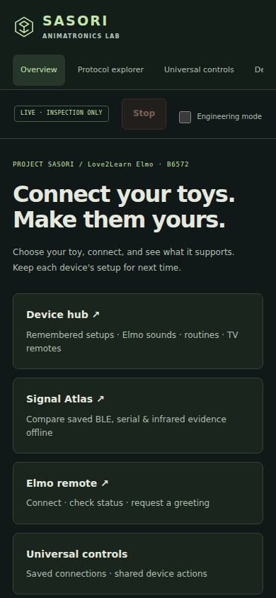
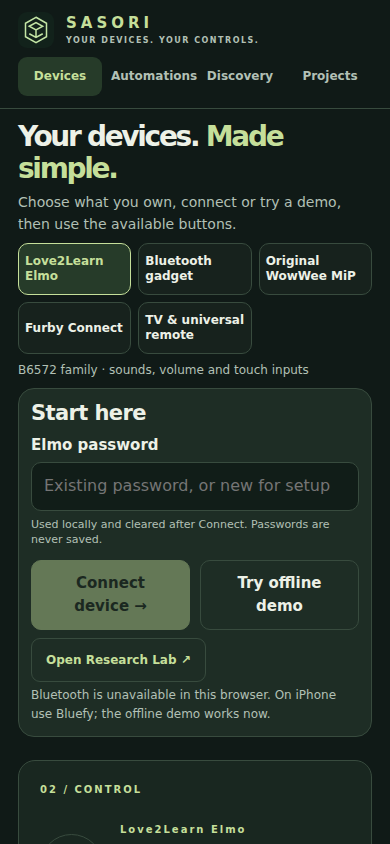
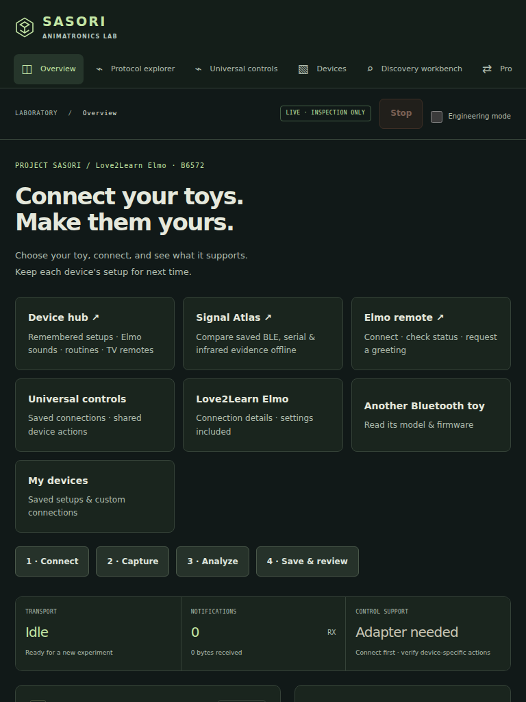
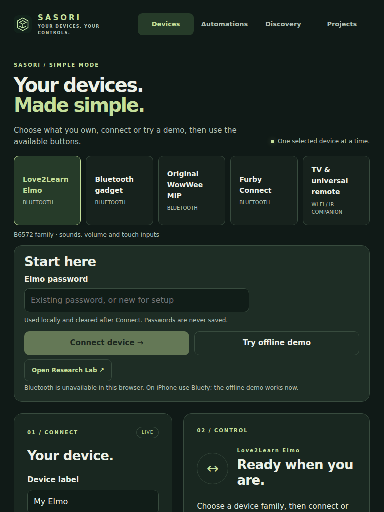
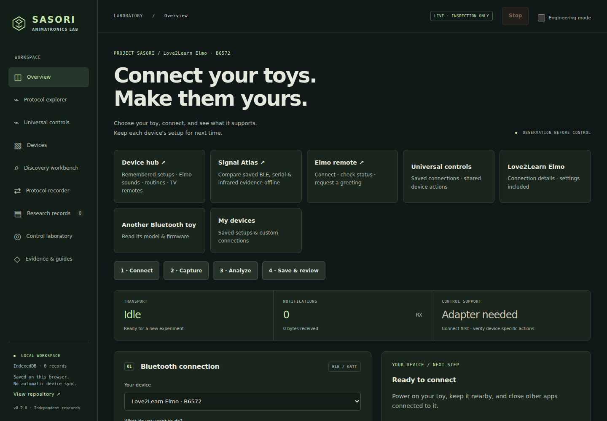
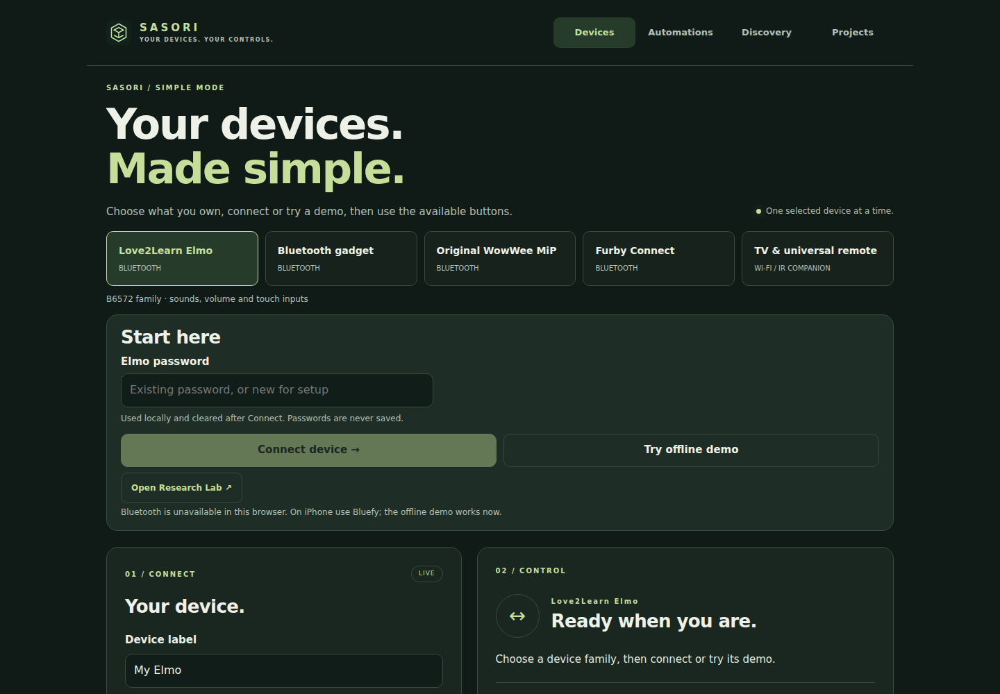

# Simple Mode release review — October 25, 2026

## Completed release

[PR #40](https://github.com/jimedusot-beep/Project-sasori/pull/40) was merged as
`bf19169c514feed2ccd82ff0bb8f25102c47845d`. Its tested head was
`9f78ce592126fed117cfa35ca3a9516e470750be`.

The hosted project root now routes to Device Hub, while direct `index.html` and
existing hash bookmarks keep the complete Research Lab. Connect, Demo, and Research
Lab are grouped after the device choice. Saved setups appear near the top when
present. Advanced filters, session length, and password setup remain available.

Review found that the first candidate still pushed actions below an iPhone viewport.
Compact phone family cards, a shorter heading, and hiding the empty saved-setup row
fixed that issue. Controls receive keyboard focus after connection; Stop remains
available during connection and active sessions. No device command or credential
storage was added.

## Exact changed files in PR #40

| Area                              | Files                                                                                          |
| --------------------------------- | ---------------------------------------------------------------------------------------------- |
| Entry and deployment verification | `site/entry.js`, `site/index.html`, `scripts/verify-site.mjs`                                  |
| Device journey and layout         | `site/hub.html`, `site/hub-ui.js`, `site/hub.css`                                              |
| Regression checks                 | `tests/entry-route.test.mjs`, `tests/browser/simple-mode.spec.js`, `tests/browser/hub.spec.js` |
| Directions                        | `README.md`, `docs/simple-mode.md`                                                             |

## Actual verification

| Check                                                       | Result and evidence                                                                                               |
| ----------------------------------------------------------- | ----------------------------------------------------------------------------------------------------------------- |
| Node tests                                                  | 300 passed                                                                                                        |
| Python source-intake/simulator-check tests                  | 7 passed                                                                                                          |
| Desktop helper tests                                        | 45 passed                                                                                                         |
| Chromium + iPhone WebKit browser checks                     | 182 passed; includes existing Elmo, TV, MiP, Furby, Discovery, recorder, routines, imports and cancellation flows |
| Formatting, lint, core type checks, credential-pattern scan | Passed                                                                                                            |
| Dependency audit                                            | No vulnerabilities reported by the run                                                                            |
| ESP32-S3 reference firmware                                 | Pinned compile passed; no flashing or physical IR testing                                                         |
| Native iOS                                                  | Unsigned simulator build, launch/render marker and screenshot passed                                              |

[Final web/firmware run](https://github.com/jimedusot-beep/Project-sasori/actions/runs/40216067917)
· [Final native run](https://github.com/jimedusot-beep/Project-sasori/actions/runs/40216067788).

Browser accessibility checks passed. Layout checks cover 360×740, 390×844,
768×1024 and 1440×1000. Buttons retain at least 44-pixel touch targets. There is no
horizontal overflow at those tested sizes. The new focus assertion verifies keyboard
handoff to the controls heading. The automated demo needs one click to start, followed
by one supported-action click; this is a scripted path, not human usability evidence.

No load-time benchmark, real device response timing, or participant study was performed.
The layout change adds no new runtime dependency or transport behavior. Existing
protocol tests and the full browser suite provide the regression evidence.

## Before and after

These screenshots reproduce the default interface before the release at main
`62022e3520aaaab39be6cf3e5e11804587bf4835` and the new Hub at the tested head.
They use clean local browser contexts in Chromium 141 with matching viewports,
without connecting hardware. Official iPhone WebKit screenshots are also in the CI
browser-verification artifact linked from the web run.

| View               | Before                                                               | After                                                                 |
| ------------------ | -------------------------------------------------------------------- | --------------------------------------------------------------------- |
| Phone, 390×844     |  |      |
| Tablet, 768×1024   |     |    |
| Desktop, 1440×1000 |   |  |

## Preserved capabilities and limits

Existing adapters, saved data schemas, routine budgets, password recovery/setup,
explicit device choice, Stop/background cleanup and expert pages remain intact.
Hosted and native stores stay local to their own browser/application origin.

Native iOS preserves its functioning Research Lab and fixed inspection/standard/MiP
bridge. It does not yet provide native Elmo/Furby Hub parity. A capability-aware native
beginner entry is tracked in [#43](https://github.com/jimedusot-beep/Project-sasori/issues/43).

Real toy effects, physical iPhone Bluetooth, and participant usability are unverified.
[#42](https://github.com/jimedusot-beep/Project-sasori/issues/42) retains the human test
protocol. The simulator and browser fixtures do not establish physical behavior.

The next software release is the consolidated Projects overview in
[#41](https://github.com/jimedusot-beep/Project-sasori/issues/41). Authenticated private
sync remains separate future work; no automatic sync is claimed.
